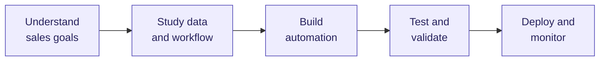
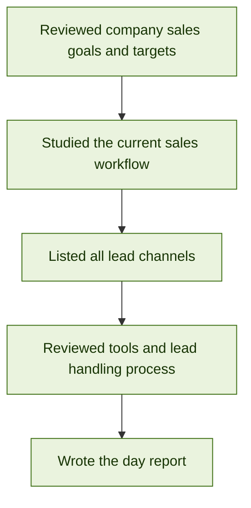

# Gemlab Sales Automation

**Role:** AI Developer
**Goal:** Increase sales at Gemlab through automation.
**Last updated:** 23 Oct 2026

---

## Approach

---

## Daily work log

Newest day first.

### Day 1 (22 Oct 2026)

**Summary**

- Reviewed Gemlab's sales goals and studied how enquiries are currently handled by the sales team.
- Leads arrive from several channels: social media (organic and paid), WhatsApp, phone calls, walk-ins and events.
- Two lead types need separate handling: franchise enquiries and gemstone enquiries.
- Lead details are currently stored in spreadsheets. A single central system would help ensure every lead is tracked and followed up.
- Follow-up messages are mostly manual reminders and can be standardised and automated.
- The team already uses a CRM and WhatsApp Business, which the automation can build on.

---

<!-- To add a new day: copy the Day 1 block, paste it above the previous day, and update the date, flowchart tasks and summary. -->
