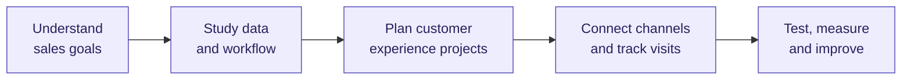
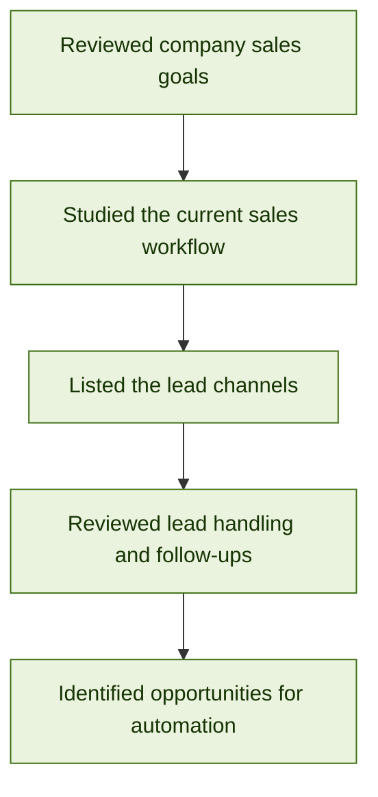
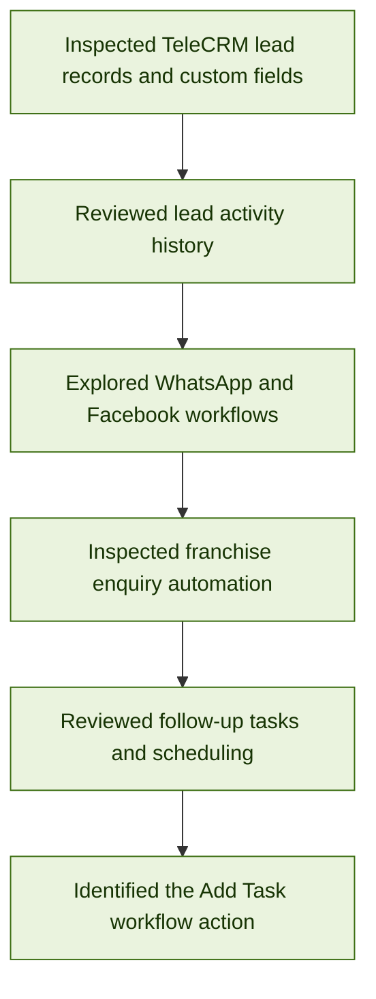
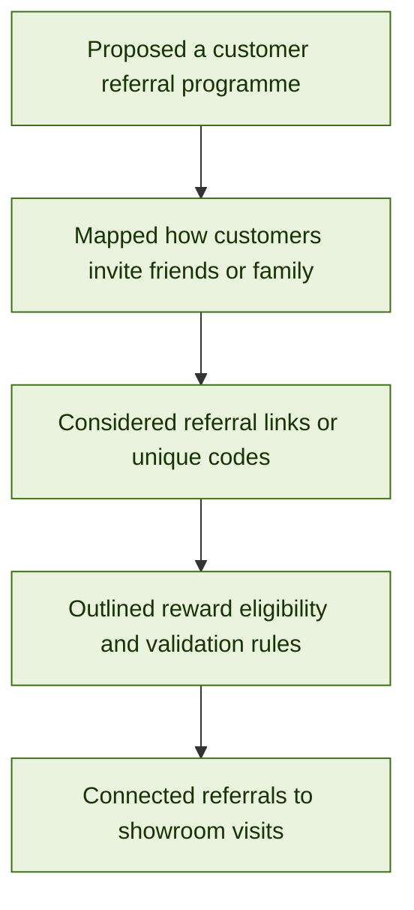
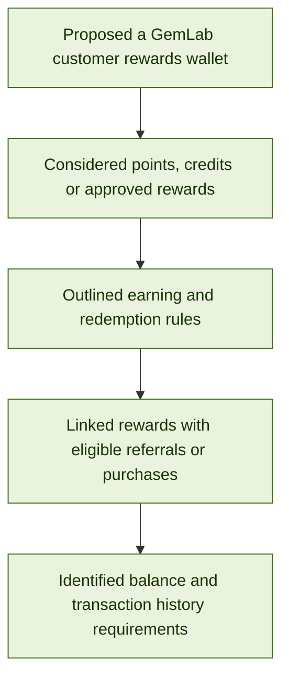
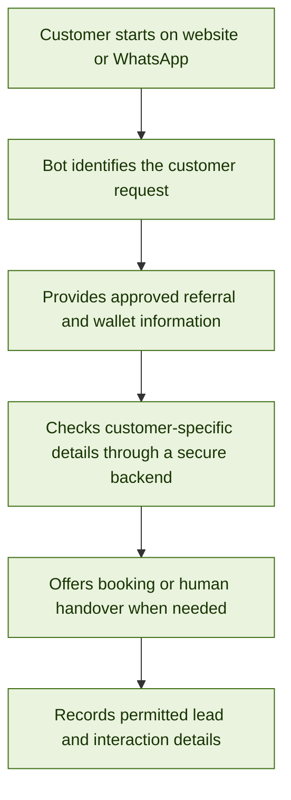
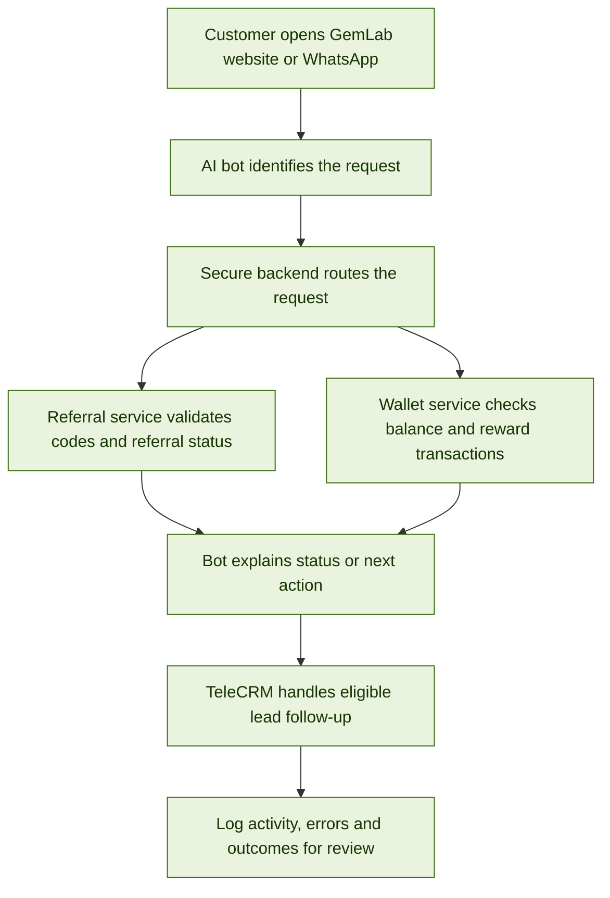
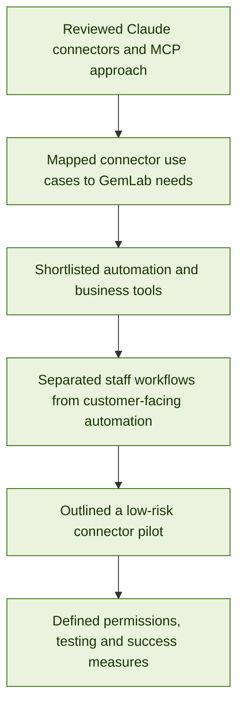

# Gemlab Sales Automation

**Role:** AI Developer  
**Goal:** Increase sales at Gemlab through automation.  
**Last updated:** 27 Oct 2026

---

## Approach

---

## Daily work log

Oldest day first. Each day has a clear title, workflow, and summary.

### Day 1 (22 Oct 2026) — Business Goals and Existing Sales Workflow

**Summary**

- Reviewed GemLab's sales goals and how customer enquiries are currently handled.
- Identified lead sources including social media, WhatsApp, phone calls, walk-ins, and events.
- Noted that franchise enquiries and gemstone enquiries need different handling.
- Reviewed the use of spreadsheets and manual follow-ups, identifying opportunities for more consistent lead tracking.
- Established that technical work should support the business goal of increasing customer visits and sales, while store staff handle in-person consultations and sales.

---

### Day 2 (23 Oct 2026) — TeleCRM Workflow and Automation Review

**Summary**

- Inspected TeleCRM lead records, custom fields, lead categories, and activity history.
- Reviewed existing WhatsApp and Facebook workflows for enquiry routing, lead assignment, and automated responses.
- Examined franchise enquiry workflows covering customer preferences, showroom visit timing, and franchise manager call requests.
- Explored the follow-up task system, including assignees, task statuses, priorities, and scheduling options.
- Identified the `Add Task` action in the workflow builder and noted items that need further verification before implementation.

---

### Day 3 (24 Oct 2026) — Customer Referral Programme: Concept and Workflow

**Summary**

- Developed the idea of a GemLab referral programme that encourages existing customers to introduce friends or family.
- Considered unique referral codes or shareable links to identify which campaign or customer generated a referral.
- Outlined business rules that need management approval, including who qualifies, when a reward is earned, and whether the referred customer must complete a verified visit or purchase.
- Identified the need to handle duplicate, invalid, or self-referrals and to track the referral from invitation through to the outcome.
- Proposed linking referral activity with appointment booking and TeleCRM so follow-ups and results can be recorded.
- **Status:** Referral programme concept and workflow planning; business rules and rewards still require approval.

---

### Day 4 (25 Oct 2026) — Customer Rewards Wallet: Features and Business Rules

**Summary**

- Developed the concept of a GemLab rewards wallet to record eligible loyalty points, referral rewards, or promotional credits.
- Proposed showing customers their reward balance, activity history, eligibility conditions, and redemption options.
- Considered connecting wallet credits to approved actions such as a valid referral, qualifying purchase, or eligible promotion.
- Identified the need for a reliable transaction record to track credits and redemptions, prevent duplicate rewards, and support customer-service queries.
- Noted that management must approve reward values, expiry rules, eligible products, redemption limits, and how store staff will validate rewards.
- **Status:** Rewards wallet concept and requirements outlined; no wallet has been built or launched.

---

### Day 5 (26 Oct 2026) — AI Customer Experience Bot for Website and WhatsApp

**Summary**

- Planned an AI customer-experience bot that can provide a consistent customer journey on both the GemLab website and the approved WhatsApp channel.
- Proposed using the bot to explain the referral programme, guide customers through referral steps, answer common rewards-wallet questions, and explain redemption rules.
- Identified that customer-specific information, such as a wallet balance or referral status, must come from a secure, authoritative backend—not be guessed by the AI model.
- Proposed connecting the bot to approved business information and the necessary backend services, with TeleCRM used for lead capture, appointment follow-up, and status tracking where supported.
- Identified the need for human handover for reward disputes, account-specific issues, unclear questions, and actions that require staff approval.
- Noted requirements for consent, privacy, authentication before exposing personal reward details, secure API-key handling, logging, and opt-out support.
- **Status:** Integration approach and initial bot use cases planned; development, provider capability checks, and end-to-end testing remain to be completed.

---

### Day 6 (Date to confirm) — Methods to Integrate and Automate the Referral Programme, Rewards Wallet, and AI Bot

**Summary**

- Planned how to combine the referral programme, customer rewards wallet, and AI customer-experience bot into one connected customer journey across the GemLab website and the approved WhatsApp channel.
- Proposed using a shared, secure backend API between the bot and the referral/wallet services, rather than letting the AI directly edit customer records or calculate trusted balances on its own.
- Outlined the referral automation flow: create or capture a referral code, associate it with a referred customer, validate eligibility, track required actions, and mark a reward as eligible only when the approved conditions are met.
- Outlined the wallet automation flow: record approved reward credits and redemptions in a transaction ledger, calculate the balance from reliable records, prevent duplicate processing, and show customers only the information they are authorised to access.
- Proposed bot intents for referral explanation, referral status, wallet balance, reward eligibility, redemption instructions, appointment requests, and requests that need staff assistance.
- Identified TeleCRM as the lead/follow-up layer where supported: capture customer enquiries with appropriate consent, record the campaign/source, create follow-up tasks, and route complex or disputed cases to the team.
- Listed integration controls to plan before build: authentication for customer-specific information, role-based access, consent and opt-out handling, secure API credentials, input validation, error handling, logging, duplicate-request protection, and human handover.
- Defined the testing approach: test referral and wallet rules separately first, then test the full website journey, the approved WhatsApp journey, TeleCRM hand-off, failed API requests, duplicate referrals, invalid codes, ineligible redemptions, and unauthorised balance requests.
- **Status:** Integration architecture and automation methods planned. The services, bot connections, and end-to-end workflows should be marked complete only after development and testing.

---

### Day 7 (27 Oct 2026) — Claude Connectors Review and Automation Opportunities

**Summary**

- Reviewed Claude's official Connectors Directory and its Model Context Protocol (MCP) approach to understand how Claude can access approved services, retrieve information, and perform permitted actions through connected tools.
- Considered using Claude with connectors for internal staff work instead of building a separate AI assistant for every small task. This could help staff find approved information, prepare campaign content, inspect business information, and run supported actions from one place.
- Shortlisted **Zapier** as the first connector candidate to investigate because it can connect Claude with many app workflows. Potential tests include sending an approved alert, creating a follow-up task, or updating a controlled spreadsheet after a defined event. The specific TeleCRM connection or API/webhook path must be verified before relying on it.
- Identified **Google Drive / Google Workspace** as a candidate for retrieving approved gemstone, policy, and campaign documents; **Google Calendar** for staff scheduling where the actual booking process supports it; and **Canva** for assisting with marketing creative production. These are shortlist candidates, not yet connected or approved for GemLab data.
- Noted that GemLab already uses TeleCRM, so a CRM migration should not be assumed. First check whether TeleCRM is supported by a suitable connector or Zapier integration; if not, evaluate its approved API, webhooks, and existing workflow builder.
- Distinguished two implementation routes: **(1) staff-facing use** — staff use Claude with selected connectors to assist with internal tasks; **(2) customer-facing use** — the website or WhatsApp channel calls a secured application/backend using the Claude API and approved business services. Connecting an app to a personal Claude chat by itself does not publish a customer-facing bot.
- Identified that event-triggered or scheduled automation still needs an appropriate workflow runner, such as a supported Zapier workflow, TeleCRM workflow, webhook, or backend job. Claude can interpret requests and choose permitted actions, but should not be treated as the only scheduler or source of truth.
- Proposed testing connectors first with low-risk, read-only or sample data, checking exact permissions and available actions, and requiring approval before any external customer message or change to customer records.
- **Outcome:** Prepared an initial connector shortlist and architecture decision for management review. No connector is recorded as connected, tested, or deployed yet.

**Initial connector shortlist**

| Candidate | Potential use at GemLab | Next check |
|---|---|---|
| [Zapier connector](https://claude.com/connectors/zapier) | Connect supported apps and automate approved cross-tool actions. | Verify TeleCRM support or an approved API/webhook route; test on sample data. |
| [Google Workspace / Drive connectors](https://support.claude.com/en/articles/10166901-use-google-workspace-connectors) | Search approved product details, policies, and campaign documents; work with relevant Google files where available. | Confirm which accounts and file permissions can be granted safely. |
| [Canva connector](https://claude.com/connectors/canva) | Help create, search, or export marketing designs and campaign material. | Review write/export permissions and require brand review before publishing. |
| [Claude Connectors Directory](https://claude.com/marketplace/connectors-plugins) | Discover other connectors based on a specific company workflow. | Shortlist only connectors tied to an agreed use case; do not connect everything. |

**Key technical distinction**

- For an internal assistant: Claude + chosen connectors may be enough for staff to request and complete supported tasks within the connected apps.
- For a public customer bot: the website/WhatsApp integration, backend, identity/consent controls, and customer-safe APIs still need to be implemented. Claude can be the model, while TeleCRM and an automation/workflow service handle routing, records, triggers, and follow-up.
- Connector capabilities, permissions, plan availability, and third-party support must be checked before implementation. Start with the smallest required permission set and keep a human approval step for high-impact actions.

**References reviewed**

- [Claude: Use connectors to extend capabilities](https://support.claude.com/en/articles/11176164-use-connectors-to-extend-claude-s-capabilities)
- [Claude Connectors Directory](https://claude.com/marketplace/connectors-plugins)
- [Claude MCP Connector API documentation](https://platform.claude.com/docs/en/agents-and-tools/mcp-connector)

---

## Proposed Next Steps

1. Confirm whether the first objective is a staff-facing Claude + connectors workflow or a public customer-facing bot.
2. Pick one narrow, low-risk workflow and inspect the exact actions and permissions of the proposed connector.
3. Verify whether TeleCRM is supported through a connector or Zapier integration; otherwise check the approved TeleCRM API/workflow/webhook options.
4. Test with sample data and read-only access first; add write actions only after review.
5. Keep customer-facing scheduled messages in approved TeleCRM, Zapier, or backend workflows, with consent and opt-out handling.
6. If customers need to use the bot on the GemLab website or WhatsApp, design the Claude API + secure backend integration separately from Claude’s staff-facing connectors.
7. Measure staff time saved, workflow success/failure, follow-up completion, and—where relevant—verified showroom visits.

## Current Status

**Planning and project scoping.** Day 7 documents connector research, the initial shortlist, and an architecture distinction between internal Claude workflows and customer-facing automation. Connectors and integrations are not recorded as connected, tested, or deployed unless those steps are completed.

<!-- To add a new day: copy the relevant Day block, keep the title specific to the work, update the date, flowchart, and summary, then place it in chronological order. -->
