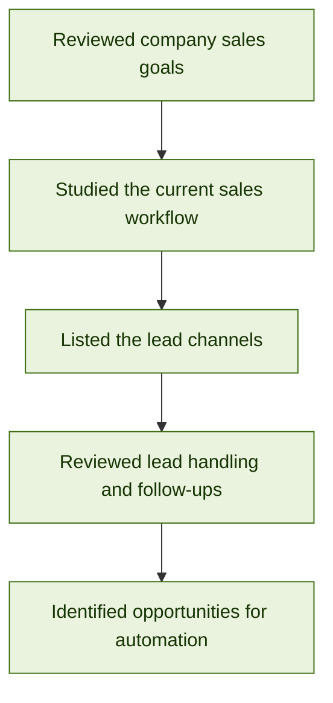
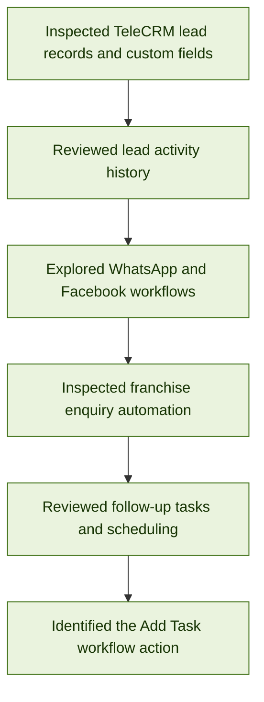
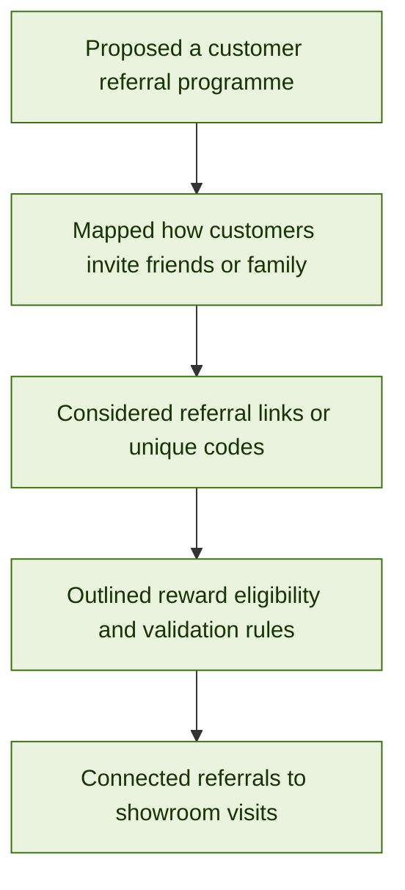
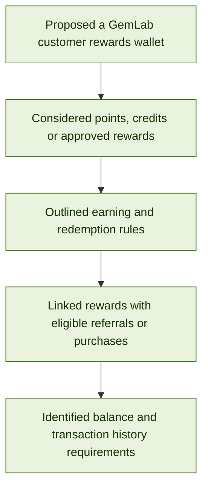
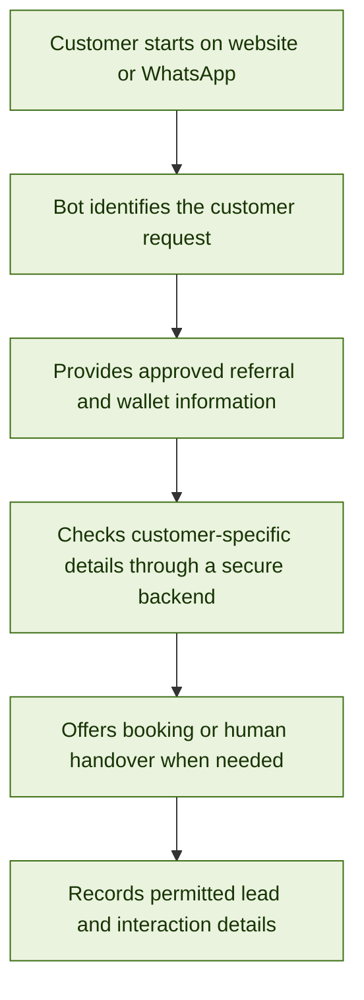
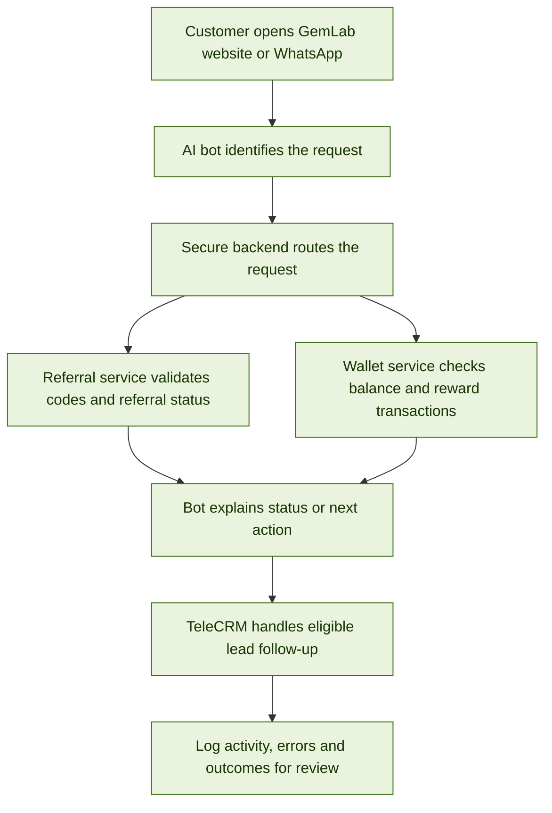
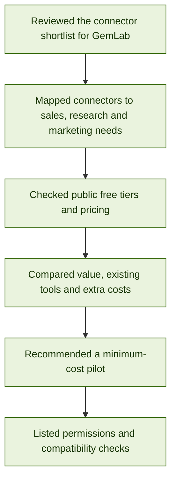

# Gemlab Sales Automation

**Role:** AI Developer  
**Goal:** Increase sales at Gemlab through automation.  
**Last updated:** 27 Oct 2026

---

## Approach

```mermaid
flowchart LR
    A["Understand sales and footfall goals"] --> B["Review existing tools and data"]
    B --> C["Research relevant Claude connectors"]
    C --> D["Compare capability, cost and permissions"]
    D --> E["Choose the lowest-cost suitable pilot"]
    E --> F["Test with limited, approved data"]
    F --> G["Measure outcomes and improve"]

    classDef step fill:#EEEDFE,stroke:#534AB7,color:#26215C
    class A,B,C,D,E,F,G step
```

---

## Daily work log

Oldest day first. Each day has a clear title, workflow, and summary.

### Day 1 (22 Oct 2026) — Business Goals and Existing Sales Workflow

**Summary**

- Reviewed GemLab's sales goals and how customer enquiries are currently handled.
- Identified lead sources including social media, WhatsApp, phone calls, walk-ins, and events.
- Noted that franchise enquiries and gemstone enquiries need different handling.
- Reviewed the use of spreadsheets and manual follow-ups, identifying opportunities for more consistent lead tracking.
- Established that technical work should support the business goal of increasing customer visits and sales, while store staff handle in-person consultations and sales.

---

### Day 2 (23 Oct 2026) — TeleCRM Workflow and Automation Review

**Summary**

- Inspected TeleCRM lead records, custom fields, lead categories, and activity history.
- Reviewed existing WhatsApp and Facebook workflows for enquiry routing, lead assignment, and automated responses.
- Examined franchise enquiry workflows covering customer preferences, showroom visit timing, and franchise manager call requests.
- Explored the follow-up task system, including assignees, task statuses, priorities, and scheduling options.
- Identified the `Add Task` action in the workflow builder and noted items that need further verification before implementation.

---

### Day 3 (24 Oct 2026) — Customer Referral Programme: Concept and Workflow

**Summary**

- Developed the idea of a GemLab referral programme that encourages existing customers to introduce friends or family.
- Considered unique referral codes or shareable links to identify which campaign or customer generated a referral.
- Outlined business rules that need management approval, including who qualifies, when a reward is earned, and whether the referred customer must complete a verified visit or purchase.
- Identified the need to handle duplicate, invalid, or self-referrals and to track the referral from invitation through to the outcome.
- Proposed linking referral activity with appointment booking and TeleCRM so follow-ups and results can be recorded.
- **Status:** Referral programme concept and workflow planning; business rules and rewards still require approval.

---

### Day 4 (25 Oct 2026) — Customer Rewards Wallet: Features and Business Rules

**Summary**

- Developed the concept of a GemLab rewards wallet to record eligible loyalty points, referral rewards, or promotional credits.
- Proposed showing customers their reward balance, activity history, eligibility conditions, and redemption options.
- Considered connecting wallet credits to approved actions such as a valid referral, qualifying purchase, or eligible promotion.
- Identified the need for a reliable transaction record to track credits and redemptions, prevent duplicate rewards, and support customer-service queries.
- Noted that management must approve reward values, expiry rules, eligible products, redemption limits, and how store staff will validate rewards.
- **Status:** Rewards wallet concept and requirements outlined; no wallet has been built or launched.

---

### Day 5 (26 Oct 2026) — AI Customer Experience Bot for Website and WhatsApp

**Summary**

- Planned an AI customer-experience bot that can provide a consistent customer journey on both the GemLab website and the approved WhatsApp channel.
- Proposed using the bot to explain the referral programme, guide customers through referral steps, answer common rewards-wallet questions, and explain redemption rules.
- Identified that customer-specific information, such as a wallet balance or referral status, must come from a secure, authoritative backend—not be guessed by the AI model.
- Proposed connecting the bot to approved business information and the necessary backend services, with TeleCRM used for lead capture, appointment follow-up, and status tracking where supported.
- Identified the need for human handover for reward disputes, account-specific issues, unclear questions, and actions that require staff approval.
- Noted requirements for consent, privacy, authentication before exposing personal reward details, secure API-key handling, logging, and opt-out support.
- **Status:** Integration approach and initial bot use cases planned; development, provider capability checks, and end-to-end testing remain to be completed.

---

### Day 6 (Date to confirm) — Methods to Integrate and Automate the Referral Programme, Rewards Wallet, and AI Bot

**Summary**

- Planned how to combine the referral programme, customer rewards wallet, and AI customer-experience bot into one connected customer journey across the GemLab website and the approved WhatsApp channel.
- Proposed using a shared, secure backend API between the bot and the referral/wallet services, rather than letting the AI directly edit customer records or calculate trusted balances on its own.
- Outlined the referral automation flow: create or capture a referral code, associate it with a referred customer, validate eligibility, track required actions, and mark a reward as eligible only when the approved conditions are met.
- Outlined the wallet automation flow: record approved reward credits and redemptions in a transaction ledger, calculate the balance from reliable records, prevent duplicate processing, and show customers only the information they are authorised to access.
- Proposed bot intents for referral explanation, referral status, wallet balance, reward eligibility, redemption instructions, appointment requests, and requests that need staff assistance.
- Identified TeleCRM as the lead/follow-up layer where supported: capture customer enquiries with appropriate consent, record the campaign/source, create follow-up tasks, and route complex or disputed cases to the team.
- Listed integration controls to plan before build: authentication for customer-specific information, role-based access, consent and opt-out handling, secure API credentials, input validation, error handling, logging, duplicate-request protection, and human handover.
- Defined the testing approach: test referral and wallet rules separately first, then test the full website journey, the approved WhatsApp journey, TeleCRM hand-off, failed API requests, duplicate referrals, invalid codes, ineligible redemptions, and unauthorised balance requests.
- **Status:** Integration architecture and automation methods planned. The services, bot connections, and end-to-end workflows should be marked complete only after development and testing.

---

### Day 7 (27 Oct 2026) — Claude Connector Research and Least-Cost Automation Planning

**Summary**

- Reviewed the supplied **GemLab: Useful Claude Connectors** shortlist and mapped each connector to a possible company use case. These are candidate tools, not confirmed live integrations with GemLab's current systems.
- **Google Drive:** first choice for searching approved GemLab FAQs, product information, policies and sales documents. Use the existing company account and limited read access wherever possible.
- **Firecrawl:** possible tool for researching public competitor websites and extracting permitted website information. The current published free tier lists 1,000 credits per month; paid Hobby is listed at US$19/month or US$16/month when billed annually. Use it only for a defined research task before paying.
- **Exa:** possible tool for discovering public business information, potential retailers and market insights. Its pricing page lists US$10 in monthly starter credits plus a US$10 onboarding bonus; paid search starts from US$4 per 1,000 requests. Review and validate leads before outreach; public contact details do not automatically mean marketing consent.
- **Windsor.ai:** candidate for comparing campaign spend and results across advertising and analytics sources. Its published free plan becomes limited to one user, one data source and one account after the trial; Basic is listed at US$19/month with annual billing or US$23/month month-to-month. Start free only if that limit is enough.
- **Funnel:** candidate for consolidating marketing data, but the published Starter plan starts at US$300/month billed annually. It is not recommended for the first low-cost pilot; begin with existing exports and a simple dashboard instead.
- **HubSpot:** relevant for CRM functions such as inactive-lead review and follow-up tasks only if GemLab decides to use HubSpot. The free CRM is listed at US$0 for up to two users, but GemLab already uses TeleCRM, so adding a second CRM could duplicate records and processes. Keep TeleCRM unless a verified gap justifies a change.
- **Bird:** a possible messaging option for email, SMS or WhatsApp, but usage and channel/provider fees can apply. Since TeleCRM is the current WhatsApp workflow, do not add Bird unless a specific capability gap and total message cost are confirmed.
- **Shopify:** useful only if GemLab's website actually runs on Shopify. Do not buy or migrate to Shopify solely to get a connector.
- Compared the staff-facing connector approach with customer-facing automation. A Claude chat with connectors can help staff work in connected tools; it does not automatically create a public customer bot. A public website or WhatsApp bot would still need an approved channel, a secure backend, application logic and separate API usage budgeting.
- **Outcome:** identified a minimum-cost order of work: test Claude's free tier with the Google Drive connector and approved documents first; use either Firecrawl or Exa free usage for a specific research need; keep TeleCRM as the CRM and WhatsApp workflow; use current exports and free dashboard tooling before considering paid marketing data platforms.

**Connector shortlist from the supplied document**

| Connector | Possible GemLab use | Least-cost recommendation |
|---|---|---|
| Google Drive | Find approved product details, FAQs, policies and sales documents. | Test first using the existing approved Google account; confirm access permissions and any current Workspace costs. |
| Firecrawl | Public competitor and website research. | Use the free monthly credits for a bounded test; upgrade only if usage proves valuable. |
| Exa | Discover businesses, retailers and market insights from public web data. | Use starter credits for small research batches; manually review results before outreach. |
| Windsor.ai | Compare campaign spend and performance across data sources. | Test the limited free tier; do not pay until a multi-source reporting need is proven. |
| Funnel | Consolidate marketing sources and reporting. | Defer because the published Starter price is much higher than a pilot needs. |
| HubSpot | CRM and follow-up actions. | Do not introduce as a second CRM while TeleCRM is active unless management approves a clear migration/use case. |
| Bird | Alternative/additional email, SMS or WhatsApp messaging. | Defer until there is a validated gap in the existing approved messaging setup and a destination-specific cost estimate. |
| Shopify (conditional) | Store orders, products and online sales analytics. | Consider only if GemLab's existing website already uses Shopify. |

**Least-cost planning — recommended sequence**

1. **US$0 pilot:** start with Claude Free, which currently costs US$0, and test the built-in Google Workspace/Drive connector with approved non-sensitive documents. Free-plan connector availability and usage limits should be confirmed in the actual GemLab account before relying on them.
2. **Use one research connector, not both at once:** choose Firecrawl for webpage extraction/crawling or Exa for web/business search based on the immediate task. Start with the published free credits and record the number of useful results obtained.
3. **Reuse existing systems:** keep TeleCRM for leads and the currently approved WhatsApp workflow; do not pay for HubSpot or Bird just to duplicate existing functionality.
4. **Report cheaply first:** export permitted campaign and sales data to a controlled spreadsheet and build a basic dashboard before adopting Windsor.ai or Funnel. Windsor.ai's free tier may be enough for a very small one-source test; Funnel's published paid Starter plan should wait until a clear need and budget are approved.
5. **Do not confuse Claude plan cost with API cost:** Claude Pro is listed at US$20/month when billed monthly or US$17/month on annual billing, but a Pro subscription does not include Claude API usage. If a customer-facing bot is later built using the Claude API, model usage is a separate cost and should be estimated with a capped test budget.
6. **Approve paid connectors only after a value test:** compare incremental costs with staff time saved, qualified leads produced, reporting time reduced, and—if a campaign is involved—verified showroom visits. Check local taxes, currency, plan limits and vendor terms before procurement.

**Security and compatibility checks**

- Confirm the precise connector publisher, official URL, supported actions, permissions and data access before connecting.
- Start read-only and with sample or low-risk data. Limit access to approved folders/accounts; do not expose customer records unnecessarily.
- Verify whether TeleCRM is available through a direct connector or a supported API/webhook path before planning automation around it.
- Require human approval before sending external customer messages, altering lead records, issuing rewards, or changing a marketing campaign.
- Review public-web leads before outreach and observe consent and applicable messaging requirements.

**References reviewed (public pricing and connector documentation checked 27 Oct 2026)**

- [Claude Connectors Directory](https://claude.com/marketplace/connectors-plugins)
- [Claude connector setup and permissions](https://support.claude.com/en/articles/11176164-use-connectors-to-extend-claude-s-capabilities)
- [Google Workspace connectors](https://support.claude.com/en/articles/10166901-use-google-workspace-connectors)
- [Claude plans and pricing](https://claude.com/pricing)
- [Firecrawl pricing](https://www.firecrawl.dev/pricing)
- [Exa pricing](https://exa.ai/pricing)
- [Windsor.ai pricing](https://windsor.ai/pricing/)
- [Funnel pricing](https://funnel.io/pricing)
- [HubSpot CRM pricing](https://www.hubspot.com/pricing/crm)
- [Bird pricing](https://bird.com/pricing)
- [Shopify pricing](https://www.shopify.com/pricing)

---

## Proposed Next Steps

1. Test Claude Free with the Google Drive connector and approved GemLab documents using the smallest practical access permissions.
2. Choose either Firecrawl or Exa for one clearly defined public-web research test; track cost and useful results.
3. Confirm whether TeleCRM has a supported connector, API or webhook route before designing any cross-tool automation.
4. Use existing exports and a simple spreadsheet/dashboard for the first marketing-performance report; defer paid reporting platforms until needed.
5. Confirm all plan limits, local pricing/taxes and permissions with the provider before enabling paid features.
6. If a public customer-facing bot is required later, budget the Claude API separately and design the website/WhatsApp integration with a secure backend and approved messaging workflow.

## Current Status

**Research and planning.** Day 7 records a connector shortlist and public pricing review to guide a minimum-cost pilot. The connectors have not been recorded as connected or tested with GemLab's systems. Vendor prices and plan limits can change; verify them again before purchasing. The lowest-cost path is to begin with Claude Free and Google Drive for approved internal knowledge, use free Firecrawl or Exa credits only where needed, and retain TeleCRM and current reporting tools until a validated gap justifies paid services.

<!-- To add a new day: copy the relevant Day block, keep the title specific to the work, update the date, flowchart, and summary, then place it in chronological order. -->
